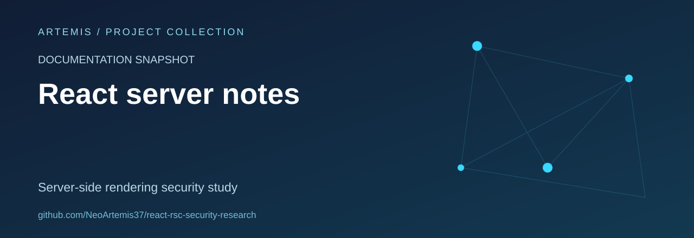

# React server security notes

A documentation-only snapshot of server-side rendering security research.

## Scope and status

This repository currently contains a README only. It does not provide an independently validated assessment, a maintained software release or a verified security advisory. Historical claims should be checked against official vendor advisories.

## Repository contents

README.md. Existing material and repository history are retained; this README is a presentation and provenance update.

## Review priorities

- Document the exact provenance and the limits of historical claims.
- Separate reproducible observations from assumptions.
- Prefer defensive analysis, local fixtures and clear remediation notes.

## Attribution and licensing

No new license or authorship claim is introduced by this documentation update. Verify the provenance and applicable permissions before reuse.

## About this collection

Maintained as part of [Artemis’s project and learning collection](https://github.com/NeoArtemis37).
